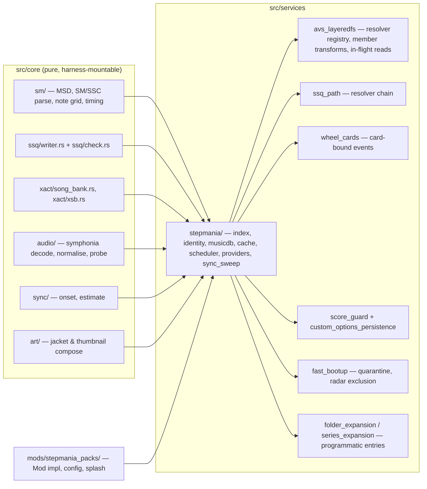
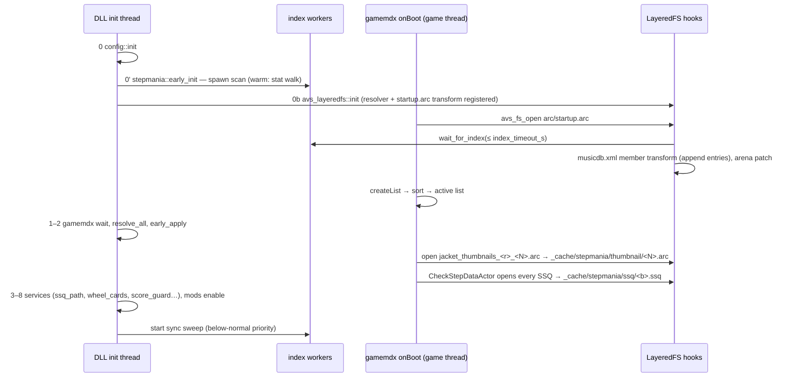

# StepMania Pack Loader — Detailed Design

Status: Approved 2026-10-21

## 1. Overview

A new top-level mod, `stepmania-packs`, lets a DDR World cabinet play StepMania song
packs dropped into `./stepmania/Songs/<Pack>/<Song>/` with no user-facing conversion step.
At boot the DLL indexes the packs, converts each eligible chart to DDR's SSQ format, and
appends matching `<music>` entries to the `musicdb.xml` the game parses out of
`startup.arc`. When the game asks for a song's assets by path — chart, sound bank, wave
bank, jacket, wheel thumbnail — the DLL produces them (MS-ADPCM XWB banks from the pack's
OGG/MP3/WAV audio, jacket/thumbnail containers from the pack's art) into a bounded cache
under `data_mods/_cache/stepmania/` and redirects the open there through the existing
LayeredFS hooks. Injected songs sit in a STEPMANIA folder and a STEPMANIA VERSION filter
entry. They never exist server-side: every play of one is tainted through `score_guard`,
so no score, lamp or flare upload leaves the cabinet, and if that protection cannot be
established the songs are hidden rather than exposed.

The feature rests on the RE recorded in `docs/stepmania_runtime_packs_feasibility.md`
(music DB construction, visibility contract, asset request sites, `music::Info` limits,
XACT bank reading) and on converters already proven in the sibling `ddr-chart-tools`
repository. Everything this design needs from those sources is restated here.

## 2. Detailed Requirements

### 2.1 Functional

| # | Requirement |
|---|---|
| F1 | Packs are discovered under the fixed root `./stepmania/Songs/<Pack>/<Song>/`; the root is created if missing when the mod is enabled. No configurable roots. |
| F2 | `.ssc` preferred over `.sm` in a song folder; `dance-single` and `dance-double` charts at Beginner/Basic(Easy)/Difficult(Medium)/Expert(Hard)/Challenge; Edit charts and other stepstypes are skipped per chart, never failing the song. |
| F3 | Audio in Ogg Vorbis, MP3 or WAV (FLAC optional); `#MUSIC` is authoritative, falling back to the first audio file in the folder. Mono is duplicated to stereo, >2 channels downmixed, 44.1/48 kHz pass through, other rates resample to 44.1 kHz. |
| F4 | Each injected song gets a unique 6-character basename and a unique mcode in a reserved window, both stable functions of its folder path, collision-checked against the musicdb it is appended to. |
| F5 | Injected songs appear in a STEPMANIA custom folder (and under a STEPMANIA VERSION filter entry when visible in ALL MUSIC); hidden from ALL MUSIC unless `exclude_from_all_music` is set to false (default true). |
| F6 | Title and artist render through the game's own fonts: the native `#TITLE`/`#ARTIST` when every codepoint exists in the song-title font, else `#TITLETRANSLIT`/`#ARTISTTRANSLIT`; `#SUBTITLE` appended as ` (subtitle)` when it fits 127 bytes. |
| F7 | Wheel preview plays the `#SAMPLESTART`/`#SAMPLELENGTH` window (clamped 5–20 s, faded) and gameplay plays the full track, both through stock-shaped XACT banks. |
| F8 | Charts preserve taps, jumps, hands, holds (rolls as holds), mines (partial rows → the modpack's type-20 mine chunk; full-row mines → shock arrows), BPM changes, stops and delays. Quads split into two rows one tick apart. Warps, negative BPM and negative stops hide the chart (`gimmick_policy = hide_chart`). `#SPEEDS`/`#SCROLLS` are reproduced as a display-only remap of the drawn note offset (judgement untouched; `scroll_gimmicks` config, default true). Per-chart SSC timing is honoured through split SSQs per level when single and double of a level agree; otherwise the double is hidden. |
| F9 | `#METER` maps to `diffLv` by clamping to 1..19. |
| F10 | Each chart is auto-synced to DDR World's timing convention using the ported `ddr-chart-tools` estimator when `auto_sync` is on (default); refusals leave the chart as authored. A song is measured once per source fingerprint. |
| F11 | Scores for injected songs are never forwarded: stage saves are suppressed; a tainted session's logout re-send has every stage/course record wiped (the existing whole-side sanitiser — stage saves already happened at results, so nothing is lost) and `<league>` stripped. Non-score profile fields (`<lastplay>`, `mod_judge_offsets`) are deliberately left alone: they round-trip harmlessly. |
| F12 | If full score sanitisation is unavailable when services come up, every injected song is hidden for the session, and any session that commits an injected song anyway has all its saves suppressed. |
| F13 | Songs that fail any check (no playable chart, unreadable audio, caps exceeded, identity collision) are dropped with one log line naming the reason; a bad song never blocks boot. |
| F14 | The boot splash reports `N StepMania songs (P packs), M rejected`. |

### 2.2 Non-functional

| # | Requirement |
|---|---|
| N1 | Warm boot cost ≤ ~200 ms per 1,000 songs (stat walk + cache load); cold scan bounded by `index_timeout_s` (30 s) after which whatever finished is injected. |
| N2 | Preview audio ready within the game's 0.4 s wheel-settle debounce for songs that have been visible on the wheel for one or more steps; a never-seen song falls back to a silent preview rather than a stall. |
| N3 | Full gameplay bank available before `DancePlaySequence::onSetup` reads it (several seconds after decide), produced progressively so the game never reads unwritten bytes. |
| N4 | Disk: ≈ 100–150 MB per 1,000 songs for boot-time artefacts (SSQ, XSB, thumbnails) plus a fixed `audio_cache_mb` LRU (default 1024) for banks and jackets, independent of library size. Nothing is written into the pack folders or the user's game data. |
| N5 | No new AOB signature in v1; every new hook target resolves by export name or is an extension of an existing owned detour. |
| N6 | All conversion runs on the DLL's own threads with host `std::fs`; the render thread is never blocked; bounded waits only on FileManager worker threads. |
| N7 | Every parse/convert path is panic-contained and input-bounded (song ≤ 60 min, audio file ≤ 256 MiB, simfile ≤ 4 MiB). |
| N8 | Pure logic lives in `crate::`-free files testable by `scripts/validate_stepmania.sh`; converters stay byte-identical with `ddr-chart-tools` where no fix was needed. |

### 2.3 Constraints inherited from the game (restated RE)

- `musicdb.xml` is a member of the resident `data/arc/startup.arc`; `music::createList` reads it from the FileManager row the moment the arc is open, inside `Application::onBoot`, before the DLL's signature scan completes. The only race-free injection point is the LayeredFS repack of that arc.
- Entries are sorted and looked up by mcode (unsigned); mcodes must be unique. `basename` is copied into a 7-byte inline buffer with a copy that stops at 6 characters; `title`/`title_yomi`/`artist` ≤ 127 UTF-8 bytes; the psmap import silently drops an entry that overflows.
- A chart is visible and playable, online or offline, when its slot has `limited_ary 0` and `diffLv` 1..254 (the server's per-chart arrays stay −1 for an mcode it never sent). Absent slots carry `limited_ary -1`, `diffLv 0`. An all-zero `diffLv` is replaced by placeholder 20s; `diffLv 255` means "ask the server".
- Reserved identities: basename `lesa`, `toho1..4`; mcodes `0x931C 0x9525 0x939D 0x9306 0x94E7 0x9733 0x950C`; `<region>` omitted so no area gate applies.
- `CheckStepDataActor` analyses every declared slot at boot; a declared slot whose analysis finds no steps raises the boot-blocking `ME1529` service error.
- Asset paths: `data/mdb_apx/ssq/<b>.ssq` or `<b>_<N>.ssq` (from `build_ssq_path`), `data/sound/win/dance/<b>.xsb` / `.xwb`, `data/arc/jacket/<b>_jk.arc` (one member `data/jacket/<b>_jk.png`, 512×512), thumbnail member `data/jacket/thumbnail/<b>_tn.dds` (192×192 DXT1) in `data/arc/thumbnail/jacket_thumbnails_<ja|ua>_<series>.arc`, requested for every series 0..=max at boot.
- The XWB is read whole into a FileManager RAM row at the wheel-settle preview and again at stage load; `wavebank_create` then `CreateFileA`s the converted path but never reads that handle.
- XSB cue names `<b>` / `<b>_s` must equal the basename byte-for-byte; the XSB CRC-16 is enforced silently (mismatch = silence).
- The musicdb property-tree arena is 1 MiB unless patched; the patch sites are two byte patterns `45 33 C0 BA 00 00 10 00 E8` / `C7 44 24 20 00 00 10 00`.
- The quantisation colour selector rounds a note's beat tick to a 1/48-beat grid before classifying 4th/8th/16th/other, so rows one tick apart share a colour.

### 2.4 Assumptions (verified by the plan's first steps)

| Tag | Assumption | If false |
|---|---|---|
| E1 | A hand-built entry (`limited_ary 0`, real `diffLv`, 7-digit mcode, 6-char basename) appears on the wheel, previews, plays and reaches results online and offline | Design invalid; stop |
| E2 | **Verified 2026-10-21:** every open and read of SSQ/XWB/jacket/thumbnail runs on one FileManager I/O worker thread, never the render thread; XWB reads are 1 MiB chunks | — (waits stall all FileManager I/O, so they stay short) |
| E3 | The stock 1 MiB arena overflows somewhere in the low thousands of entries | Arena patch becomes optional rather than mandatory |
| E5 | **Partially verified 2026-10-21:** an unloadable `_jk` draws as a flat coloured square (no crash); missing `_tn` untested | Thumbnails become mandatory before declaration |
| E6 | **Verified 2026-10-21:** the logout save's `<lastplay><mcode>` carries the injected mcode (and is stored server-side); `eventlog_3.write` / `pcbevent.put` do not; `mod_judge_offsets` lists only tuned basenames | — (sanitiser scope = `/lastplay` + offsets filter + stage/logout records) |
| E7 | Rows one tick apart are judged independently without engine misbehaviour; a stop one tick before a delay beat judges the beat's notes after it | Quads reduce to jumps; delays hide the chart |
| E8 | Radar axis maxima are library-global | Accumulator exclusion unnecessary |
| E9 | No level-20 art exists | Clamp to 20 |

## 3. Architecture Overview

### 3.1 Placement



`core/` gains the ported converters; `services/stepmania/` owns everything game-facing;
the mod is thin. Neighbouring services gain small APIs rather than the StepMania code
reaching into them.

### 3.2 Boot timeline



The index decision is final once the `startup.arc` open returns: songs indexed later are
not injected this boot (they are cached for the next).

### 3.3 Runtime flows

**Wheel.** The song wheel is a two-dimensional grid — three songs per row, scrolling
sideways within a row and vertically between rows — so the visible set is ~3 × (visible
rows) cards. `wheel_cards` fires `on_card_bound(mcode)` each time a wheel card is bound to
a song, i.e. when a row scrolls into view. For injected mcodes the scheduler enqueues
*preview bank* and *jacket* jobs; the highlighted song (from `selectmusic_highlight`) is
re-prioritised to the head of the queue, the rest run in binding order. A horizontal move
therefore never lands on an unprepared song, and a vertical scroll has one row of three
new previews to build (≈ 150–600 ms total on one worker, under the time it takes to read
a new row and settle). On settle the game opens `<b>.xsb`/`<b>.xwb` in scene 25; the
resolver returns the preview variant's cache path, waiting (bounded, worker thread only)
if the job is still running, else a silent preview variant.

**Decide.** On the scene-26 commit the scheduler starts the *full bank* job for the
committed mcode (speculatively already started if the song was highlighted for ≥ 1.5 s),
the score taint is latched, and the auto-sync measurement runs on the same decode if the
song is unmeasured and `auto_sync` is on. `DancePlaySequence::onSetup` opens the banks
outside scene 25; the resolver returns the full variant's path, which exists from the
job's first millisecond as a progressive file (complete header, body filled in order);
the LayeredFS read hook holds any read past the written watermark until the writer
catches up.

**Play / results / logout.** Stock behaviour; the taint suppresses the stage save; the
logout sanitiser strips injected records; `reset_session` clears the taint.

### 3.4 Delivery model

All artefacts are real files under `./data_mods/_cache/stepmania/` and are served by the
existing path-redirecting hooks. A *resolver* registered with LayeredFS maps a normalised
game path to a cache path (or `Pending`). Boot-time artefacts (SSQ, XSB, thumbnail arcs)
are complete before the game can ask for them. Banks and jackets are produced on demand
into a byte-budgeted LRU. The full bank is written progressively so its open never waits
on encoding; the read hook enforces the watermark.

## 4. Components and Interfaces

### 4.1 `core/sm/` — simfile parsing (new, pure)

Ported from `ddr-chart-tools` (`src/ssc/{mod,notes,msd}.rs`, `src/sm/mod.rs`,
`src/model/`) with these behavioural changes:

| Area | Behaviour |
|---|---|
| Text | Bytes decoded as strict UTF-8, else Shift-JIS, else Windows-1252 (`encoding_rs`). Tokenizer operates on `&str`. |
| Tolerance | Trailing commas / empty entries in `#BPMS`/`#STOPS`/`#DELAYS`, scientific notation, CRLF, BOM. Unknown tags ignored. |
| Per-chart isolation | Unsupported `#STEPSTYPE`, unknown/case-variant `#DIFFICULTY` (→ Edit), unclosed hold, bad row → that chart is dropped with a reason; the song survives. |
| Note chars | `K`, keysound `[n]`, attack `{…}` stripped; `F`, `L` dropped; `4` → hold (counted); `M` per row classification as the tool. |
| Timing | `#DELAYS`, `#WARPS` (and negative BPM / negative stops) parsed into the model, not dropped. `#FAKES` ranges parsed; notes inside them dropped. Per-chart `#OFFSET/#BPMS/#STOPS/#DELAYS/#WARPS` kept on the chart. |
| Song tags | `#TITLE/#TITLETRANSLIT/#SUBTITLE/#SUBTITLETRANSLIT/#ARTIST/#ARTISTTRANSLIT/#MUSIC/#OFFSET/#DISPLAYBPM/#SAMPLESTART/#SAMPLELENGTH/#JACKET/#BANNER/#BACKGROUND/#SELECTABLE`, `#METER` per chart. |

Output: `Song { meta, timing: Timing, charts: Vec<Chart { style, difficulty, meter, timing: Option<Timing>, notes }>, warnings }`.

### 4.2 `core/ssq/writer.rs`, `core/ssq/check.rs` — SSQ synthesis (new, pure)

Writer ported from `src/ssq/writer.rs` plus the private glue (`synthesize_events`,
`chart_end_tick`, `extend_tempo_pairs_to`), with:

- **Quad split**: a row whose panels would OR to `0x0F`/`0xF0`/`0xFF` on a non-shock row is emitted as `L+R` at tick *t* and `D+U` at *t+1* (per side on doubles); freeze heads likewise; the freeze block carries both.
- **Delays**: a stop of the delay's duration at the delay beat's tick − 1.
- **Gimmicks**: with `hide_chart`, any warp / negative BPM / negative stop in the chart's effective timing marks the chart `Unrepresentable`. (`approximate` is a later policy.)
- **Per-chart timing**: charts grouped by effective timing. If all charts share the song timing → one `<b>.ssq` with all charts. Otherwise, per level *N* whose single and double share one timing → `<b>_N.ssq` carrying that level's charts and its own tempo chunk; a level whose single and double disagree keeps the single and hides the double. The resolver answers `build_ssq_path(b, N)` accordingly.
- **Lead-in**: `tempo_data[0] = −#OFFSET·1000 + lead_in_ms` where `lead_in_ms` is the smallest whole-ADPCM-block multiple making `tempo_data[0] ≥ 60` (auto-sync headroom), first note tick ≥ 4096 and ≥ 2 s of audio before the first note. The same `lead_in_ms` of silence is prepended to the PCM.
- **Events**: `(0,1,4) (0,2,1) (4096,2,2) (4096,2,5) (end−4096,2,3) (end,2,4)`; `end` = last note incl. freeze tails rounded up to a measure + 2 measures; tempo anchors extended to bracket END.
- **`shift_seconds(ssq, delta_ms)`**: pure rewrite of the tempo chunk's seconds column (auto-sync application).

`check.rs` re-parses the produced bytes with the existing `core/ssq` walker and verifies:
tempo monotonic with no zero-Δms/non-zero-Δtick segment; FINISH/END bracketed; END ≥ last
note; every declared slot has ≥ 1 tap/jump/shock row; no non-shock row carries a shock
byte; chunk layout walkable by `fast_bootup::ssq_chunk_list_walkable`. Only passing slots
are declared.

### 4.3 `core/xact/song_bank.rs`, `core/xact/xsb.rs` — bank writers (new, pure)

- `SongBankPlan::new(rate, frames_main, frames_preview, basename) -> plan` computes the whole XWB layout up front (v43/header 42, flags `0x0009_0001`, 2048 alignment, data at `0x800`, entries **main = 0, preview = 1** — stock order — 64-byte names, seek tables sized from the fixed 140-byte/128-sample MS-ADPCM block). `plan.total_len()`, `plan.header_bytes()`, `plan.offset_of(entry, block)`.
- `write_blocks(sink, plan, entry, blocks)` appends encoded blocks; the encoder is the in-tree `core/xact/adpcm.rs` (harness-checked against the tool's decoder).
- `xsb::write_song_profile(basename) -> Vec<u8>` ported from `src/xsb/mod.rs::write` (complex-first cue order, CRC-16), golden-byte tested.
- The result must pass `core/xact/xwb.rs::parse_song_bank` strictly so `song_rate` binds it unchanged.

### 4.4 `core/audio/` — decoding and normalisation (new, pure)

`symphonia` with features `mp3`, `vorbis`, `wav`, `pcm` (`flac` optional). `probe(bytes)
-> AudioInfo { codec, rate, channels, frames_exact }` (Vorbis: last-page granule; MP3:
Xing/VBRI header else a frame-header walk; WAV: data chunk). `Decoder::open(bytes) ->
impl Iterator<Item = StereoBlock>` yields 128-frame stereo i16 blocks after
mono→stereo / downmix / resample (`core/xact/resample.rs` for rates ∉ {44100, 48000}),
with `lead_in_frames` of silence prepended and the stream padded or truncated to the
planned frame count. No MP3 gapless trimming (`enable_gapless = false`). Preview windows
are produced by seeking to `#SAMPLESTART`, decoding `#SAMPLELENGTH` (clamped 5–20 s, default
start = ⅓ of the song, length 15 s) and applying 0.25 s / 1.5 s linear fades.

### 4.5 `core/sync/` — auto-sync (new, pure)

Port of `ddr-chart-tools/src/sync/{onset,estimate,events,timemap}.rs` with `rustfft`;
constants (`TARGET_OFFSET_MS = −2.11`, cap 60 ms, refusal gates) unchanged so the
calibration holds. Input: the decoded mono-folded PCM and the chart's weighted tap events;
output: `Outcome::{Apply{delta_ms}, Unchanged, Refused(reason)}`. Per split SSQ when
per-chart timing produced several.

### 4.6 `core/art/` — jacket and thumbnail (new, pure)

`compose_jacket(sources) -> RgbaImage(512²)` with the priority `#JACKET` (centre-crop) →
`#BACKGROUND` → `#BANNER` → filename heuristics (`*jacket*`, `*bn*`, `*bg*`, aspect-ratio
classified) → pack art → shipped placeholder; every non-square source is FITTED inside the
square over a blurred, darkened cover-scaled copy of itself (maintainer 2026-10-23: a 4:3
background is far closer to square than a banner, and nothing is cropped away).
First frame of animated GIFs; alpha flattened; Lanczos resize (`image`). `jacket_arc(b,
png) -> Vec<u8>` (ARC v1, member `data/jacket/<b>_jk.png` **stored uncompressed** — an
LZ77-compressed PNG member renders as a flat coloured square, spike run 2026-10-21; stock
PNG jackets are all stored raw; `core/arc.rs` writes uncompressed so this is the default). `thumbnail_dds(img) ->
[u8; 18560]` (192² BC1 via `texpresso` + 128-byte DDS header); `thumbnail_arc(members)`.

### 4.7 `services/stepmania/` — the feature service

| Module | Responsibility |
|---|---|
| `mod.rs` | `early_init()` (step 0'): read config, check the root, spawn the scan, register the LayeredFS resolver + `startup.arc` transform, register pending folder/series entries. `init(ctx)` (step 3+): subscribe to `wheel_cards`, `scene_manager`, hook into `score_guard`, start the sync sweep. `status()` for the splash and `is_injected(mcode)`, `is_injected_basename(&str)`. |
| `index.rs` | Walk `<root>/<Pack>/<Song>`; per song pick the simfile, parse, resolve audio/art files, probe audio, allocate identity, convert + self-check SSQs, write SSQ/XSB, compose thumbnail; produce `SongEntry`. Warm path: fingerprint `(path,size,mtime)` of simfile+audio+art; unchanged → reuse the cached entry and existing artefacts. `wait_ready(deadline) -> IndexSnapshot`. Workers = `available_parallelism().clamp(2, 6)`. |
| `identity.rs` | Pure. `basename(pack, song) = "z" + base36(fnv1a64(casefold(pack + "/" + song)))[..5]`; `mcode = 9_000_000 + hash % 1_000_000`; deterministic probing on collision within the index; the transform drops (with WARN) entries colliding with the base musicdb. |
| `musicdb.rs` | Pure. `entry_xml(&SongEntry, series, property_bit) -> String` (schema §5.4, UTF-8-boundary truncation to 127 bytes, XML escaping, `title_yomi` generation). `transform(xml: &[u8], entries, base_ids) -> Vec<u8>` inserts before `</mdb>` after parsing the base document's mcodes/basenames for collisions. |
| `cache.rs` | Layout §5.3; byte-budgeted LRU over `xwb/` and `jacket/` (`audio_cache_mb`), touch-on-serve, evict-on-insert; `index.bin`, `sync.bin` load/save; invalidation on fingerprint change; `_cache/stepmania` wholesale deletable. |
| `scheduler.rs` | Priority job queue on a small worker pool (preview, jacket, full bank, sync). Pool size ≥ 3 so a freshly bound wheel row's three previews run concurrently; priority order: highlighted-song preview > visible previews (binding order) > highlighted jacket > visible jackets > speculative full bank > sync. Dedupe by `(mcode, kind)`; cancel speculative full-bank jobs when the highlight leaves after a grace period; `PendingTicket` handed to the resolver. |
| `providers.rs` | `resolve(norm_path, ctx) -> Resolution::{Ready(path), Pending(ticket, fallback), None}`; variant selection: preview when `scene_manager::current_scene() == 25`, full otherwise; silent preview fallback (`xwb/_silent/<b>.xwb`, generated on demand, tiny). Writes the progressive full bank (`§4.8`). |
| `sync_sweep.rs` | Below-normal-priority thread walking unmeasured songs when the scene is not gameplay; result → `sync.bin` and an atomic SSQ rewrite (`tmp` + rename). |
| `taint.rs` | Scene-26 commit observer: reads the committed mcode from `stage_records`; if injected → `score_guard::set_injected_song_taint()` + `mark_session_tainted(side)` for entered non-bot sides; fail-closed hiding (§4.13). |

### 4.8 `services/avs_layeredfs` — three additions

1. **Resolver registry** (`mod_paths.rs`): `register_resolver(fn(&str) -> Option<String>)`; `find_first_modfile` consults registered resolvers *after* the mod list, so an operator's mod folder still wins and every DLL-side reader (`chart_length`, `fast_bootup` identity, dancers' tempo source, split discovery) sees the materialised files through the call it already makes. `file_hooks::find_mod_replacement` additionally calls `resolve_open(norm_path)` for the `Pending` case: if `!widget_renderer::is_render_thread()` (in practice the FileManager's single I/O worker, E2) it waits up to `open_wait_ms` (preview 300 ms, full 2 s — short, because that worker serves every FileManager read) then falls back to the resolution's fallback path; on the render thread it takes the fallback immediately and WARNs once.
2. **Member transforms** (`arc_handler.rs`): `register_member_transform(arc_norm_path, member_path, fn(&[u8]) -> Option<Vec<u8>>)`, applied after overlays during `handle_arc`; the cache hasher gains `extra_fingerprint(arc) -> Option<u64>` contributions (the StepMania index fingerprint) and hashes the original arc's bytes rather than its AVS path. The `startup.arc` transform also runs the in-open arena patch (§4.9).
3. **In-flight reads** (`file_hooks.rs`): the open hook records `fd → ProgressiveFile { watermark: Arc<AtomicU64>, done: Arc<AtomicBool> }` when the resolved path is registered as progressive; the read hook, for such fds only (range/table check before any other work), waits until `watermark ≥ cursor + n` or `done`, bounded (5 s, then passes through). Entries are dropped when `done` is observed or on the next open of the same fd value. No new detours: open and read are already hooked; lseek/close/fstat stay unhooked (the fstat size is the planned total length, which the progressive file is pre-sized to via `set_len`).

### 4.9 Arena patch in the `startup.arc` open

`song_limit_expansion` exposes `apply_arena_patch(module) -> bool`, idempotent. The
`startup.arc` transform calls it after locating `gamemdx` by module name (it is mapped —
the open comes from its `onBoot`) with a targeted two-pattern scan; `early_apply` then
no-ops. A `transform_ran` flag is published; `lib.rs` WARNs once if the music DB vector is
non-empty while the flag is clear (LayeredFS missed the open).

### 4.10 `services/ssq_path.rs` — resolver chain (promoted)

Owns the single `build_ssq_path` detour (signature already exists). `register(priority,
fn(basename, difficulty) -> Option<String>)`; consumers: StepMania provider (injected
basenames → `<b>.ssq` or `<b>_N.ssq` from the index), `split-ssq-auto-discovery` (its
existing rule-A resolver, now a consumer), stock format as the terminal fallback. The
detour is installed when any consumer registers.

### 4.11 `services/wheel_cards.rs` — card-bound events (promoted)

Owns the wheel-card refresh detour from `s_marvelous/lamp_badge.rs`; reads `card+0x148`
and resolves the mcode via `selectmusic_highlight::mcode_of_holder`; `on_card_bound(fn(mcode,
holder))` subscribers: `s_marvelous` (lamp), `stepmania::scheduler` (prefetch).

### 4.12 `folder_expansion` / `series_expansion` — programmatic entries

`folder_expansion::register_runtime_folder(CustomFolderEntry)` and
`series_expansion::register_runtime_series(CustomSeriesEntry)`, callable at step 0' and
merged into the config lists before each mod's `init`. StepMania picks the lowest free
`bit_index ≥ 10` and the lowest free series value ≥ 22 not used by the operator's config,
keyed `stepmania` with shipped art (`data_mods/stepmania_packs/…` folder textures and the
`sefi_version_stepmania` label). `exclude_from_all_music` passes through to the folder
entry. Both registrations happen only when the index has ≥ 1 song.

### 4.13 Score isolation (`score_guard`, `custom_options_persistence`, `per_song_judgement_offsets`)

- `score_guard::set_injected_song_taint()` — global like `QUICK_FAIL_TAINT`, included in `is_stage_suppressed`, cleared by `reset_song_taint`/`reset_session`.
- Logout sanitiser: the existing whole-side wipe (every stage/course record → mcode −1, `<league>` stripped) is the correct model — per-stage saves of untainted songs already happened at their results screens, so the logout re-send loses nothing. No targeted mode.
- `/lastplay` and `mod_judge_offsets`: E6 showed `<lastplay><mcode>` carries the committed mcode and the server stores it; `mod_judge_offsets` lists tuned basenames. Both are non-score profile fields that round-trip harmlessly and are left untouched (maintainer decision 2026-10-23). `eventlog`/`pcbevent` were clean in E6.
- **Fail-closed**: at the end of mod enable, if `score_guard::is_full_sanitization_available()` is false or taint registration failed, every injected entry gets its corruption flag set via `find_music_by_mcode` using `fast_bootup`'s derived `+0x1B0` anchor (the next active-list rebuild hides them) and a `HIDDEN_FOR_SAFETY` state suppresses all saves for any session committing an injected mcode regardless.

### 4.14 `fast_bootup` — quarantine and radar exclusion

`CheckStepDataActor::onUpdate` detour: for items whose mcode satisfies `stepmania::
is_injected`, a corruption outcome sets `+0x1B0`, WARNs with the basename, and skips the
`ME1529` reporter; such items are also excluded from the radar-axis maxima fold. Identity
needs no change: materialised SSQs are real files (`Identity::File`), and an auto-sync
rewrite changes mtime → that song's items re-analyse once.

### 4.15 `mods/stepmania_packs/` — the mod

`id = "stepmania-packs"`, default ON. `required_signatures()` empty. `is_active()` = root
exists ∧ LayeredFS available (boot-only semantics). `init` wires subscriptions; `enable`
is a no-op beyond publishing the splash line; disabling from the menu takes effect next
boot (`early_init` is config-gated). Config section `stepmania_packs` (operator-only,
never written): `exclude_from_all_music` (false), `audio_cache_mb` (1024), `auto_sync`
(true), `index_timeout_s` (30), `gimmick_policy` (`hide_chart`).

## 5. Data Models

### 5.1 `SongEntry` (index record, ~1 KB)

```
SongEntry {
  pack: String, folder: String,                // display + identity source
  basename: [u8; 6], mcode: u32,
  title, title_yomi, artist: String (≤127 B), bpm_min, bpm_max: u16,
  slots: [SlotDecl; 10],                        // {level: u8 (0 = absent), ssq_file: u8 (0 = <b>.ssq, 1..5 = <b>_N.ssq)}
  audio: { rel_path, codec, rate, channels, frames_exact, lead_in_frames, preview: {start_frame, len_frames} },
  art: { jacket_src: Option<rel>, kind: JacketSourceKind },
  sync: SyncState::{Unmeasured, Applied(delta_ms), Refused(reason)} per ssq_file,
  fingerprint: u64,                             // simfile + audio + art (path,size,mtime)
  rejects: Vec<(chart_id, Reason)>,
}
```

Slot index = `difficulty + 5·(style == double)`; slot 5 (double Beginner) is never declared.

### 5.2 Identity derivation

`key = casefold(pack_folder) + "/" + casefold(song_folder)`; `h = fnv1a64(key)`;
`basename = "z" + base36(h)[0..5]` (ASCII `0-9a-z`); `mcode = 9_000_000 + (h >> 40) %
1_000_000`. Collision inside the index → probe `h = fnv1a64(key + "#" + i)`, i = 1.. in
sorted-key order. Collision with the base musicdb (basenames and mcodes parsed from the
post-overlay XML) → drop + WARN.

### 5.3 Cache layout (`./data_mods/_cache/stepmania/`)

```
index.bin                 fingerprint-guarded SongEntry table (+ PE stamp of gamemdx)
sync.bin                  identity → SyncState
ssq/<b>.ssq | <b>_N.ssq   complete, atomically replaced
xsb/<b>.xsb
thumbnail/<series>.arc    one arc for the STEPMANIA series, served for both _ja_ and _ua_ names
jacket/<b>_jk.arc         LRU
xwb/<b>.xwb               full bank, progressive (pre-sized), LRU
xwb/<b>.p.xwb             preview variant (real <b>_s, 1-block silent <b>), LRU
xwb/_silent/<b>.xwb       silent preview fallback, tiny
lru.bin                   touch order + sizes
```

### 5.4 Injected `<music>` element

```xml
<music>
  <mcode __type="u32">9xxxxxx</mcode>
  <basename>zab12c</basename>
  <title>…</title><title_yomi>…</title_yomi><artist>…</artist>
  <bpmmax __type="u16">…</bpmmax><bpmmin __type="u16">…</bpmmin>
  <series __type="u8">S</series>
  <property __type="u32">1&lt;&lt;B</property>
  <diffLv __type="u8" __count="10">l0 l1 l2 l3 l4 0 l6 l7 l8 l9</diffLv>
  <limited_ary __type="s32" __count="10">0/-1 per slot</limited_ary>
</music>
```

Types/attributes mirror the stock entries byte-for-byte in form; `region`, `movie*`,
`eventno*`, `voice`, `bgstage`, `genreflag`, `bemaniflag` omitted. `title_yomi` = lowercase
ASCII alphanumerics of the transliterated title with parentheticals wrapped in `'…'`.

### 5.5 Config section

```json
"stepmania_packs": {
  "exclude_from_all_music": true,
  "audio_cache_mb": 1024,
  "auto_sync": true,
  "index_timeout_s": 30,
  "gimmick_policy": "hide_chart"
}
```

Operator-only; absent section = defaults.

### 5.6 Progressive bank

`ProgressiveFile { path, planned_len, watermark: Arc<AtomicU64>, done: Arc<AtomicBool> }`.
Writer: create, `set_len(planned_len)`, write header, then blocks in file order (main
entry first, preview entry last), publishing `watermark` after each `write_all`. Both
entries' first 64 KiB are written first (bank prepare primes every entry).

## 6. Error Handling

| Stage | Failure | Handling |
|---|---|---|
| Scan | Unreadable folder, oversize simfile/audio, undecodable text | Song dropped, one WARN with reason; counted as rejected |
| Parse | Per-chart error | Chart dropped; song survives if ≥ 1 chart remains |
| Convert | `Unrepresentable` (gimmick), self-check failure | Slot not declared; song dropped if no slot remains |
| Identity | Collision with base musicdb | Song dropped + WARN (never renumbered on the fly) |
| Transform | Index not ready by `index_timeout_s` | Inject the finished subset, WARN once; the rest next boot |
| Transform | LayeredFS missed `startup.arc` (flag clear, DB populated) | WARN once; mod inactive this boot |
| Arena patch | Patterns not found | WARN; inject anyway (E3 decides whether to cap N) |
| Boot analysis | Zero-step slot despite self-check | `fast_bootup` quarantine: hide, WARN, no `ME1529`; without fast-bootup the self-check is the only guard |
| Preview open | Job not ready within 300 ms / render-thread open | Silent preview variant; WARN once per boot |
| Full bank open | Not started | Start now; progressive file exists within ms; reads wait on the watermark (≤ 5 s per read, then pass through = brief silence rather than a hang) |
| Encode | Decoder error mid-stream | Remaining blocks zero-filled, `done` set, WARN; song marked `audio_failed` in the index for next boot |
| Art | Decode failure | Placeholder jacket / thumbnail |
| Auto-sync | Refused | Chart as authored; reason persisted; no retry until the fingerprint changes |
| Score | Sanitisation unavailable | Hide all injected songs; suppress all saves of any session that commits one |
| Any hook body | Panic | `catch_unwind` → pass through to the original + WARN (existing LayeredFS pattern) |

## 7. Testing Strategy

**Host harness** `scripts/validate_stepmania.sh` mounts the pure files (`core/sm`,
`core/ssq/{writer,check}`, `core/xact/{song_bank,xsb,adpcm}`, `core/audio`, `core/sync`,
`core/art`, `services/stepmania/{identity,musicdb}`) and runs:

- parser fixtures: SM and SSC with CRLF/BOM/Shift-JIS, trailing commas, keysounds/attacks, rolls, lifts, fakes, quads, hands, per-chart timing, delays, warps, Edit, unknown stepstype, duplicate difficulties;
- SSQ: byte-identity against `ddr-chart-tools` output for a corpus needing no fix (`DDR_CHART_TOOLS` env var, skipped if absent); self-check negatives (mines-only, holds-only, zero-Δms tempo, END before last note, shock-byte leak); quad-split placement and colour-class invariance (`q = round(tick·3/64)`) across standard quantisations; delay nudge;
- banks: XSB golden bytes for 4/5/6-char codes; XWB plan vs tool output (same entries, bytes identical per entry; order differs by design) and strict `parse_song_bank` acceptance; ADPCM encoder vs tool decoder round trip;
- audio: symphonia vs lewton Vorbis within ±1 LSB on fixtures; MP3 frame-count probe vs decode; mono/downmix/resample shapes; lead-in arithmetic;
- auto-sync: estimator vs CLI `--auto-sync report` within ±1 ms on fixtures; refusal paths;
- musicdb: fragment validates against the psmap schema (types, counts, 127-byte limits), identity determinism and probing, collision drop;
- LRU budget accounting.

**Dry-run tool** `tools/sm_pack_check/` (host crate mounting the same files): converts a
pack folder to a scratch directory, prints per-song verdicts and rejection reasons, the
musicdb fragment, and bank/SSQ sizes — operators vet packs before a cabinet ever sees them.

**Cabinet** (the only validation for engine-facing code; each a plan step with a log/visual
check): E1 hand-built entry end-to-end online and offline; E2 thread ids on virtual opens;
E3 arena headroom at N = 100/500/1000; E6 request-log capture after an injected play; E7
quad-split and delay test charts; E5/E9 art fallbacks; zero `ME1529` with a real pack of
hundreds of songs; preview audible within the settle on a neighbour-prefetched song;
progressive full bank plays with no dropouts; no `/result` forwarded (dev-server log);
logout re-send free of injected mcodes; stock songs unaffected (radar, folders, flare).

## Appendix A — Technology choices

| Choice | Rationale |
|---|---|
| `symphonia` (pure Rust) | MP3/Vorbis/WAV/FLAC in one dependency; builds under cargo-xwin and the Win7 `-Z build-std` leg; untrimmed MP3 by default matches StepMania's libmad sync |
| `rustfft` | Pure Rust; the estimator's calibration depends on its exact onset parameters, not on the FFT implementation |
| `encoding_rs` | Shift-JIS packs are common |
| In-tree `adpcm.rs` over the tool's encoder | One codec in the DLL; already exercised by `song_rate` and `assist_tick` |
| Materialised cache over virtual fds | No new AVS hooks, persistence across boots, real paths for every existing host-path reader; bounded by `audio_cache_mb` |

## Appendix B — Alternatives considered

- **`createList` detour / hand-built `music::Info`**: lose the `onBoot` race or re-implement sort, active list, boot analysis and three heaps. Rejected.
- **Virtual fds**: zero disk but three new detours, an fd table, a `CreateFileA` placeholder and an unproven fd range. Deferred to v2 behind the same provider interface.
- **Per-pack folders / series labels**: need a runtime text rasteriser (none exists). v2.
- **Hold the stage start until the bank is ready**: the bank is read at `onSetup`, before READY; replaced by progressive files + watermark reads.
- **Display-list ±K lookahead**: the model's known list is the pre-filter base list; wheel-card binding gives neighbour visibility without new RE.
- **Path/git dependency on `ddr-chart-tools`**: pulls `clap`/`env_logger`/C libvorbis/`rustfft`; the private `job/` glue would still need lifting.

## Appendix C — Performance budget (estimates unless marked measured)

| Work | When | Cost |
|---|---|---|
| Cold scan per song | boot workers | parse 1–5 ms, probe ~1 ms, SSQ + check < 5 ms, thumbnail 5–15 ms |
| Warm scan | boot | stat walk; tens–200 ms per 1,000 songs |
| Transform | inside the `startup.arc` open | 10–50 ms per 1,000 songs; +0.4 MB XML |
| Boot analysis | boot | 5 items/song; replayed from fast-bootup cache on warm boots (whole library ~42 ms, measured) |
| Preview bank | on card bound | 50–200 ms |
| Jacket | on card bound | 20–80 ms |
| Full bank | on highlight dwell / decide | ~1–2 s per 2-min song single-threaded (encoder ~55 ns/sample measured under CrossOver), parallel ADPCM blocks |
| Auto-sync | with the full decode | +0.5–1 s per song |
| Memory | steady | index (~1 KB/song) + scheduler buffers; banks are files |
