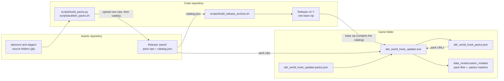
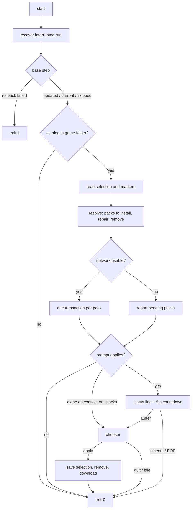
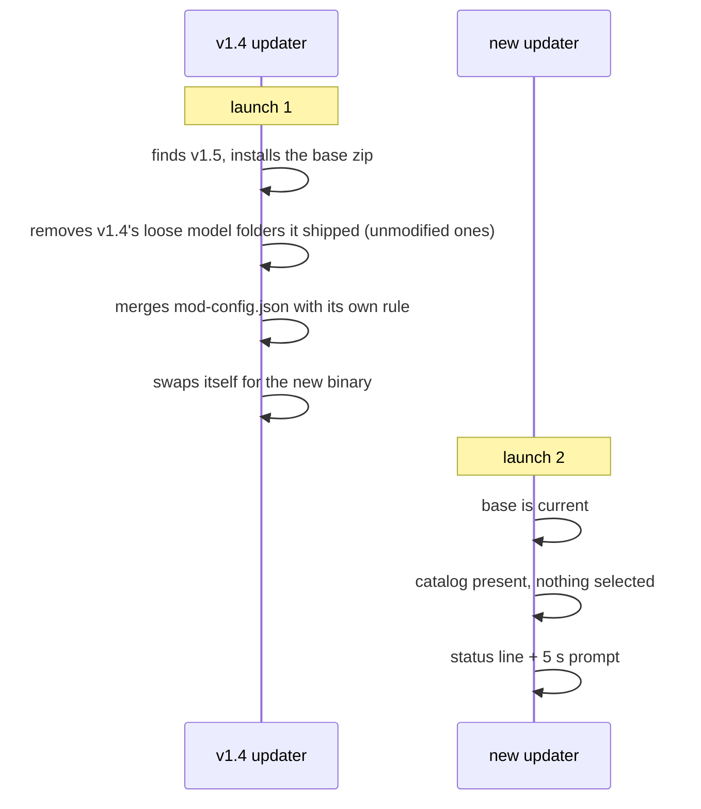

# Detailed Design: Optional Content Packs

Status: Approved 2026-11-11

## 1. Overview

The modpack ships as one zip per GitHub release, installed and kept current by
`ddr_world_hook_updater.exe`. Since v1.4 the repository has gained about 3.5 GB of
ported dancers and stages under `data_mods/custom_models/`. That content can no longer
ride in the release zip — every installed updater rejects archives above 2 GiB
uncompressed — and most of it is unwanted by any given user.

This design:

1. Splits the ported models into **packs**, one per source folder (for example the
   3rd MIX dancers, the SuperNOVA 1 & 2 stages), that users opt into individually.
2. Moves the models out of the code repository into a separate **assets repository**,
   whose GitHub release also stores the pack zips.
3. Extends the updater to download, update, repair and remove packs, with a 5-second
   prompt on every run that opens a console checklist.
4. Guarantees the updater never touches models it did not ship.
5. Refines where the updater inserts option rows that a user's `mod-config.json` lacks.

The base release stays a single zip named as today, so cabinets on v1.3 / v1.4 update
to it with the updater they already have.

## 2. Detailed Requirements

### 2.1 Packs and the base release

- **P1** A pack is one ported source folder of one kind:
  `data_mods/custom_models/dancers/<Source>/` or `…/stages/<Source>/`. There are 15
  dancer packs and 8 stage packs today.
- **P2** The base zip contains everything it contains today except the ported sources.
  The `Custom` dancer and stage sources (the maintainer's own models) stay in the base.
- **P3** A pack zip is rooted at the game folder, so unzipping it by hand into the game
  folder installs it. It carries its own marker file (P9).
- **P4** The base asset keeps the name pattern `ddr-world-universal-modpack-*.zip` and
  stays below 2 GiB uncompressed. Pack assets are named
  `ddr-world-pack-<pack id>-<content id, 12 hex>.zip`.

### 2.2 Hosting and identity

- **P5** The ported models live in git in a separate repository,
  `skogaby/ddr-world-universal-modpack-assets`. Its one release, tagged `packs`, is used
  as file storage for every published pack zip and for `catalog.json`.
- **P6** A pack's **content id** is a SHA-256 over its packed files (path and hash of
  each, in sorted order). Identical models give an identical id on every build; any
  change gives a new one. A pack is uploaded only when no asset with its name exists.
- **P7** Publishing uploads new pack zips, then replaces `catalog.json`. A modpack
  release build downloads the current `catalog.json` and embeds it in the base zip as
  `ddr_world_hook_packs.json`. A release therefore pins exact pack revisions, and new or
  changed packs reach users only with a modpack release.
- **P8** The updater never searches releases for packs. It reads the catalog from the
  game folder and downloads each pack from the URL the catalog gives.

### 2.3 Records

- **P9** Each installed pack is recorded by a marker,
  `data_mods/custom_models/.packs/<pack id>.json`, listing the pack's content id and its
  files with size and hash. The marker is shipped inside the pack zip.
- **P10** The user's selection is stored in `ddr_world_hook_updater.packs.json` in the
  game folder. It is plain JSON and may be edited by hand.
- **P11** The base install manifest keeps its schema and never lists pack files.

### 2.4 A run

- **P12** Order of a normal run: recover an interrupted run, update the base, bring
  every selected pack to the catalog's revision and repair damaged ones, show the pack
  prompt.
- **P13** The pack prompt appears on **every** normal run: one status line, then
  "press Enter" with a 5-second countdown. Enter opens the chooser. No input means the
  updater exits and the game starts. There is no setting that disables it.
- **P14** The prompt is skipped only where it cannot apply: `--check`, `--packs-list`,
  `--packs-install`, no catalog or an empty one, and a failed rollback. When standard
  input is closed or redirected the read ends immediately and counts as "no".
- **P15** Double-clicking the updater (it is alone on its console) or passing `--packs`
  opens the chooser directly, without the countdown.
- **P16** Pack failures never stop the game from starting and never roll back the base.
  A failed pack is retried on the next run. The exit-code contract is unchanged: 0
  whenever the game can start, 1 only when a rollback failed, 3 for `--check`.
- **P17** A pack that is new in a release is installed automatically only when the user
  ticked "also install packs added by future releases". Otherwise it is named in the
  status line and marked NEW in the chooser.
- **P18** The countdown and each download's progress redraw one console line in place.
  The log file records the start and the result of each download only.

### 2.5 Ownership of files

- **P19** A path the modpack does not ship — not in the base zip, not in a selected
  pack — is never read, written or removed. This includes files a user adds inside a
  shipped source folder.
- **P20** A path the modpack ships is its own. Missing or modified files of the base and
  of selected packs are restored. There is no separate repair command.
- **P21** Damage to a selected pack is detected on every run by presence and size of
  each recorded file. Full hashes are compared only with `--force`. A damaged pack is
  re-downloaded whole.
- **P22** Deselecting a pack, or a release dropping a pack the user had selected,
  removes the recorded files that are unmodified. Modified ones are kept and reported.
  Folders are removed only when empty.
- **P23** `data_mods/_cache/` is never touched.

### 2.6 Option rows

- **P24** A row missing from the user's `custom_options.option_menu_settings` is
  inserted in the section it has in the release, by the existing rule. One refinement:
  when the row is more closely named after the release neighbour that follows it than
  after the one that precedes it, it is inserted directly before that following
  neighbour, wherever the user put it. Existing rows, their order and their flags are
  never changed.

### 2.7 Tooling

- **P25** Pack building and publishing are scripted; uploads use the `gh` CLI.
- **P26** Tools find the assets checkout beside the code checkout
  (`../ddr-world-universal-modpack-assets`) or through `DDR_WORLD_ASSETS`. There is no
  absolute fallback path.
- **P27** `--packs-dir <folder>` makes the updater take pack zips from a local folder,
  so private builds can be tested without publishing.

### 2.8 Out of scope

- An in-game page for choosing packs.
- Teaching the DLL the release's row order. Users who keep an old `mod-config.json` and
  never run the updater see unlisted rows at the end of the menu; rows of a `ShowWhen`
  family (which includes the dancer and stage source rows) already stay beside their
  relative.
- Packs for anything other than dancers and stages. The catalog format allows it;
  nothing produces it.
- Resolving a user model whose key equals a shipped model's key. The DLL keeps the
  first and warns; the updater only reports it (Section 4.9).

### 2.9 Assumptions

- **A1** The assets repository is public before v1.5 is published. Release files of a
  private repository cannot be downloaded without credentials, and cabinets have none.
- **A2** With no selection file, the selection starts as the set of packs whose markers
  are present. This covers packs unzipped by hand and full images.
- **A3** After a selection file exists, a run without the chooser acts only on selected
  packs. An installed but unselected pack is left alone and shown ticked in the chooser.
- **A4** `--check` exits 3 when the base or any selected pack needs installing.
- **A5** The prompt reads a line (Enter), not a raw key press.
- **A6** Packs are listed in the catalog's order: dancers, then stages, each sorted by
  folder name.
- **A7** Each chooser question gives up after 5 minutes without input and applies
  nothing, so a cabinet cannot hang in it.
- **A8** The Windows image script produces a full image when the assets checkout is
  present and a base-only image with a notice otherwise.
- **A9** The 49 commits of model history are not carried into the assets repository; it
  starts from one commit.

## 3. Architecture Overview



Three properties follow from this shape:

- **Cutting a modpack release needs neither the assets checkout nor a packing step.** It
  downloads one small JSON file.
- **A pack is uploaded once per revision.** A hotfix release that changes no model
  uploads nothing to the assets repository.
- **The DLL and its models cannot drift.** The catalog inside a base zip names the pack
  revisions that existed when that base was built.

### 3.1 A run, end to end



"Network usable" is false when the base step already failed to reach GitHub; the pack
step then does no downloads rather than waiting on one timeout per pack. A transport
failure during a pack download likewise ends pack downloads for that run.

## 4. Components and Interfaces

### 4.1 Assets repository

Layout: `dancers/<Source>/…`, `stages/<Source>/…` (the shape of a `custom_models` base,
authoring form), `.gitattributes`, `README.md`.

`.gitattributes` contains `* -text`. The source folders hold 845 text sidecars with LF
endings; without the rule a Windows checkout with `core.autocrlf` would rewrite them and
every content id would differ on that host.

Size: about 500 MiB as a git pack, no file above 40 MB. Both are inside GitHub's limits
(files blocked above 100 MB, pushes above 2 GB).

### 4.2 `scripts/build_packs.py`

Lives in the code repository beside `scripts/pack_custom_models.py`, which it imports.
Subcommands:

| Subcommand | Does |
|---|---|
| `build` | Packs the assets checkout into a mirror (every model folder becomes its ready `.arc`, sidecars copied), then per source folder: hashes the files, derives the content id, writes the marker, and writes the zip unless an asset of that name is listed in `--existing <names file>`. Emits a local catalog. |
| `catalog` | Combines the local catalog with the shelf's asset listing (name, size, digest) into the final `catalog.json`. Fails if any pack has no asset on the shelf or the asset has no digest. |
| `stage` | Copies packed files and markers into a game-folder image (used by the Windows image script and for local testing). |
| `check` | Validates a catalog file: schema, id and asset-name character sets, URL prefix, unique ids. |

Rules:

- Pack id: `<kind>-<slug>`, the slug being the folder name lower-cased with every run of
  non-alphanumerics replaced by `-` (`dancers-3rd-mix`, `stages-supernova-1-2`). Two
  folders yielding one id fail the build.
- Content id: SHA-256 of the concatenation, over the pack's files in byte-sorted path
  order and excluding the marker, of `<path>\n<sha256 hex>\n`. Paths are game-folder
  relative.
- Zip: entries in sorted order, marker last, fixed timestamps, deflate level 9.
- Title: the source folder name. Item count: the number of models.

### 4.3 `scripts/publish_packs.sh`

1. Refuses to run without `gh`; warns when the assets checkout has uncommitted changes.
2. Creates the `packs` release in the assets repository if it does not exist.
3. Lists the shelf's assets, runs `build_packs.py build --existing …`.
4. Uploads the new zips.
5. Lists the shelf again, runs `build_packs.py catalog`, and uploads `catalog.json`
   replacing the previous one. Zips first and catalog last, so a published catalog never
   names a file that is not there.
6. Fetches the catalog URL without credentials and warns loudly if that fails (the
   repository is still private).

Superseded pack zips are left on the shelf; cabinets on an older base still point at
them. They can be deleted by hand once old.

### 4.4 Release build

`scripts/build_release_archive.sh`:

- Stages `data_mods/` with `custom_models/` limited to the `Custom` sources, so a local
  copy or symlink of the ported models can never leak into the base zip.
- Obtains the catalog with `gh release download packs --pattern catalog.json` from the
  assets repository, or from the file named by `PACKS_CATALOG`. Runs
  `build_packs.py check` on it and stages it as `ddr_world_hook_packs.json`. Fails if no
  catalog can be obtained.
- Fails if the staged tree exceeds 2 GiB.
- Warns in its closing summary when the catalog URL is not reachable anonymously.
- The tester `.bat` passes `--packs-dir "%~dp0packs"` when a `packs` folder sits beside
  it.

`scripts/build_release_distribution.bat` stages the base the same way and then runs
`build_packs.py stage` when the assets checkout is found.

The code repository's `.gitignore` ignores every folder under
`data_mods/custom_models/dancers/` and `…/stages/` except `Custom/`.

### 4.5 Updater: run sequence

`main.rs` keeps `run_default` / `run_from_zip` / `install` as the base step. They return
their outcome plus whether GitHub was reachable. A new `packs::run_step` follows for
every outcome except a failed rollback, then `packs::prompt`. The final outcome is the
base outcome, raised to `RollbackFailed` if a pack transaction's rollback failed, and to
`UpdateAvailable` under `--check` when pack work is pending.

New module tree `updater/src/packs/`:

| Module | Responsibility |
|---|---|
| `catalog.rs` | Parse and validate `ddr_world_hook_packs.json`. |
| `state.rs` | Read markers; read and write the selection file. |
| `resolve.rs` | Pure decision: what to install, repair, remove; the status line. |
| `install.rs` | One pack transaction: obtain zip, extract, plan, apply. |
| `chooser.rs` | The checklist: pure input parsing and rendering, plus the loop. |

### 4.6 `packs::resolve` (pure)

Inputs: catalog, selection, installed markers, a disk probe (exists and size; hash on
demand), `force`. Outputs:

- **Install** for each selected catalog pack whose marker is absent, whose marker names
  a different content id, or whose recorded files fail the check (P21).
- **Remove** for each selected id that the catalog no longer contains and that has a
  marker. The id is then dropped from the selection.
- **Adopt** for catalog packs that are not in the selection's `known` list when
  `install_new` is set: they are added to the selection and installed.
- The status line: packs installed out of packs available; names of packs not in
  `known`; count of packs waiting for a download.

### 4.7 Download with resume (`download.rs`)

`fetch_asset` is generalised to take a name, URL, expected size and optional SHA-256
instead of a GitHub asset, and a `resume` flag used for packs only. The base download
behaves as today.

With `resume`: the transfer writes to `<name>.part` in `.ddr_world_hook_updater/packs/`.
An existing part file is hashed, then the request carries `Range: bytes=<length>-`. A
`206` whose `Content-Range` starts at that length appends; a `200` starts over; a `416`
discards the part and starts over. On a transport error the part file is kept. After the
last byte, size and SHA-256 are checked against the catalog; a mismatch deletes the file.
Part files and zips that no needed pack refers to are deleted at the start of the step.

GitHub's release download URLs redirect to a signed URL that honours `Range` (observed:
`206`, `Content-Range: bytes 1000-1999/26626795`). Whether `ureq` forwards the `Range`
header across that redirect has not been observed; the first implementation step proves
it against a real asset and, if it does not, resolves the redirect itself.

With `--packs-dir`, a zip of the asset's name in that folder is used in place of the
download and verified the same way; a missing one falls back to the URL.

Before a download, free space on the game folder's volume must cover the zip plus the
pack's installed size plus 64 MiB (`GetDiskFreeSpaceExW`; the check is skipped on other
hosts). Too little space fails that pack with a message naming the shortfall.

### 4.8 Pack archives (`archive.rs`)

A pack mode beside the existing release mode. It keeps the checks on unsafe names,
symlinks, entry count and total size, drops the requirement for `ddr_world_hook.dll`,
and adds:

- every entry is under the catalog's `root` for that pack, or is exactly the pack's
  marker path;
- the marker parses, and names the catalog's pack id and content id;
- the marker's file list equals the archive's other entries.

Any violation rejects the archive before anything is written. A pack zip can therefore
write only inside its own source folder and its own marker.

### 4.9 Pack plan and apply (`plan.rs`, `apply.rs`)

Install plan for one pack, with the on-disk marker in the role the previous manifest
plays for the base:

1. `Write` every staged file (existing files are backed up first).
2. For each file of the old marker that the new pack lacks: `Prune` if its hash equals
   the old record, else `KeepModified`.
3. `Write` the marker, last. An interrupted install therefore still shows the old
   revision and is repeated.

Removal plan: for each recorded file, nothing if missing, `Prune` if its hash equals the
record, `KeepModified` otherwise; then `Prune` the marker.

`apply::execute` takes a transaction descriptor (label, backup subfolder, actions, stage
root, and optionally merged files and the manifest) in place of its current fixed
arguments. Three behaviours change:

- **Backups are per transaction**: `backup/base/`, `backup/<pack id>/`. Today the backup
  folder is emptied at the start of every apply, which would let the first pack
  transaction delete the backup of the base update that just ran. It is now emptied once
  per run, by the first transaction.
- **The journal records its backup subfolder** (absent in a journal written by an older
  updater, which means the backup folder itself). Recovery restores from it.
- **A committed pack transaction trims its backup**: only files that were detected as
  modified (size differing from the old marker's record) or that had no record are kept;
  unmodified shipped files are deleted. Otherwise a run that updates every pack would
  leave 3 GB of redundant backups.

After a pack install, the updater lists `pl_*.arc` / `mapset_*.arc` names and model
folder names elsewhere under the same kind that equal a name the pack just installed,
and logs one warning per collision. It changes nothing.

### 4.10 Console (`console.rs`, `log.rs`)

- **`LineReader`**: one background thread reads standard input line by line into a
  channel for the whole run. Every timed read (the prompt, each chooser question, the
  existing "press Enter to close") is a `recv_timeout` on that channel. Today's wait
  spawns a reader per call, which cannot be repeated.
- **Timed prompt**: pending console input is discarded first
  (`FlushConsoleInputBuffer`), then the countdown runs. Only a complete line counts as
  yes. End of input, a read error and the timeout count as no.
- **Live line**: a console-only write of `\r` plus text padded to the previous length,
  used for the countdown and for download progress. Live lines are at most 79 columns,
  since a redraw that wraps on an 80-column console leaves debris. When standard output
  is not a terminal, live lines are not written at all.
- The checklist is written to the console directly, not as log lines. The log records
  that the chooser opened, what was chosen, and each resulting action.

### 4.11 Chooser (`packs/chooser.rs`)

```
==========================================================================
 OPTIONAL PACKS            4 of 23 selected, 82 MB to keep on disk
==========================================================================

 DANCERS
   1 [x] 3rd MIX            16 dancers    23 MB   installed
   2 [x] 4th MIX            18 dancers    29 MB   installed, update available
   8 [ ] HOTTSTPARTY 5      18 dancers    23 MB   NEW
 …
 STAGES
  21 [x] SUPERNOVA 1 & 2    22 stages      6 MB   installed

   f [ ] Also install packs added by future releases

 Type numbers to switch packs on or off, e.g. "1 2 3" or "16-20".
 d = all dancers   s = all stages   a = everything   n = nothing
 Enter = apply     q = leave without changing anything
 >
```

- Line based, no cursor control, so it works on Windows 7 consoles and under Wine.
- A pack is shown ticked when it is selected or installed.
- Enter on an empty line shows what would be downloaded and removed and asks
  `Go ahead? [Y/n]`. On yes: the selection is saved first (so interrupted downloads
  resume on the next run), then removals, then downloads.
- Opening the chooser records every catalog pack as `known`.
- Sizes shown are download sizes; the header shows the installed size of the selection.

### 4.12 Command line

| Flag | Meaning |
|---|---|
| `--packs` | Open the chooser after the update steps, without the countdown. |
| `--packs-install <all\|none\|id,id,…>` | Set the selection and apply it; no prompt. `all` also ticks future packs. Unknown ids are reported and ignored. |
| `--packs-list` | Print the catalog with each pack's state; no network, no changes. |
| `--packs-dir <DIR>` | Take pack zips from this folder. |

Existing flags keep their meaning. `--force` additionally hash-checks selected packs.
`--check` reports pending pack work. Malformed invocations still print usage and exit 0.

### 4.13 Option-row merge (`merge/option_menu.rs`)

The existing rule places a missing row after the nearest preceding release sibling the
user still has in that section, else at the section's end, else right after the header.
The refinement, applied to non-header rows only:

1. Let P be that preceding sibling (possibly none).
2. Let N be the nearest following release sibling of the same release section that the
   user has **anywhere** in the list.
3. Count the leading `_`-separated words the new row's id shares with N and with P.
4. If N exists, shares more words than P, and is not already at the insertion point,
   insert immediately before N. Otherwise the existing rule applies.

Checked against the repository's `mod-config.json` with a transcription of the rule:

| User list | Before | After |
|---|---|---|
| v1.3 default, v1.4 default | equals the release order | equals the release order |
| release order minus any one or two rows (all 1 176 cases) | equals the release order | equals the release order |
| v1.4, `ddr_selection` moved to the top of its section | `background_dancer_source` follows `ddr_selection` at the top | directly before `background_dancer` |
| v1.4, dancer and stage rows moved under another header | both source rows stay behind at the end of the old section | each directly before its row in the new place |

Known limit, unchanged: when a user moved a section's last row elsewhere within the
section, rows the release adds after it follow it there instead of going to the
section's end. A rule sending such rows to the section end was tried and rejected; it
broke 33 of 1 826 round-trips of the release order.

The v1.4 → v1.5 merge is performed by the updater already installed, so the refinement
first applies to the release after v1.5. Lists in the default order are placed correctly
in v1.5 regardless.

### 4.14 Documentation

`README.md`: what packs are, the prompt and the chooser, the new flags, manual
installation (a link to the assets repository's `packs` release), and the statement that
models the user added are never touched. The Blender add-on's port examples and their
documentation name the assets checkout as the place ported sources are written.

## 5. Data Models

### 5.1 Catalog — `ddr_world_hook_packs.json` (game folder; shipped in the base zip)

```json
{
  "schema": 1,
  "packs": [
    {
      "id": "dancers-3rd-mix",
      "group": "Dancers",
      "title": "3rd MIX",
      "items": 16,
      "root": "data_mods/custom_models/dancers/3rd MIX",
      "content_id": "<64 hex>",
      "asset": "ddr-world-pack-dancers-3rd-mix-a1b2c3d4e5f6.zip",
      "url": "https://github.com/skogaby/ddr-world-universal-modpack-assets/releases/download/packs/ddr-world-pack-dancers-3rd-mix-a1b2c3d4e5f6.zip",
      "zip_size": 24117248,
      "zip_sha256": "<64 hex>",
      "installed_size": 80740352
    }
  ]
}
```

Validation on read: `schema` is 1; `id` and `asset` use `[a-z0-9.-]`; `root` is a clean
relative path under `data_mods/`; `url` is `https`; ids are unique. An unusable catalog
disables the pack step for that run with one warning.

### 5.2 Marker — `data_mods/custom_models/.packs/<id>.json` (shipped in the pack zip)

```json
{
  "schema": 1,
  "id": "dancers-3rd-mix",
  "content_id": "<64 hex>",
  "files": {
    "data_mods/custom_models/dancers/3rd MIX/Afro/pl_ddr3afro00.arc": { "size": 4812736, "sha256": "<64 hex>" }
  }
}
```

The DLL's model scanner skips directories whose name starts with a dot, so `.packs/` is
invisible to the game. A deleted or unreadable marker means "not installed".

### 5.3 Selection — `ddr_world_hook_updater.packs.json` (game folder)

```json
{
  "schema": 1,
  "packs": ["dancers-3rd-mix", "stages-supernova-1-2"],
  "install_new": false,
  "known": ["dancers-3rd-mix", "dancers-4th-mix", "stages-supernova-1-2"]
}
```

`packs` is what the user wants installed. `install_new` is the "future releases" tick.
`known` is every pack id the user has been shown in the chooser or that was adopted
automatically; catalog packs outside it are "new". An unreadable file is left untouched
and the run proceeds as if the selection were the installed packs; the next chooser save
replaces it.

### 5.4 Journal and work directory

`journal.json` gains `backup_subdir` (string, default empty). Work directory layout:

```
.ddr_world_hook_updater/
  download/            base zip (as today)
  packs/               pack zips and .part files, kept across runs
  stage/               extraction area, one transaction at a time
  backup/base/         files replaced by the base update
  backup/<pack id>/    modified files replaced by a pack transaction
  journal.json         present only during a transaction
```

### 5.5 Owners of files in the game folder

| Path | Owner | Updater behaviour |
|---|---|---|
| `ddr_world_hook.dll`, `README.md`, `data_mods/` outside the rows below, `ddr_world_hook_packs.json` | base release | written every update; dropped files removed if unmodified |
| `mod-config.json`, `judgement_offsets.csv` | user | merged, never overwritten |
| `data_mods/custom_models/{dancers,stages}/Custom/` files in the base zip | base release | as the first row |
| files listed by an installed pack's marker | that pack | restored when missing or modified while selected; removed on deselection if unmodified |
| `data_mods/custom_models/.packs/` | updater | markers |
| any other file under `data_mods/custom_models/` | user | never read, written or removed |
| `data_mods/_cache/` | DLL and prep tool | never touched |
| `ddr_world_hook_updater.packs.json` | user and updater | written by the chooser and `--packs-install` |

## 6. Error Handling

| Situation | Behaviour |
|---|---|
| Catalog missing | Pack step and prompt skipped silently (a base older than v1.5). |
| Catalog unreadable or wrong schema | One warning; pack step and prompt skipped. |
| Selection file unreadable | Warning; file left alone; selection treated as the installed packs. |
| GitHub unreachable in the base step | No pack downloads this run; pending packs listed; prompt still shown. |
| Transport error during a pack download | Part file kept; no further pack downloads this run; retried next run. |
| Pack URL returns 404 | That pack fails with the URL in the message; other packs continue. |
| Size or SHA-256 mismatch | Download deleted; pack fails; retried next run from zero. |
| Not enough disk space | That pack fails with the shortfall; smaller packs may still install. |
| Pack archive violates confinement or disagrees with its marker | Rejected before extraction; pack fails. |
| Pack transaction fails mid-apply | Rolled back from `backup/<pack id>/`; old revision stays installed. |
| Pack rollback fails | Journal left in place; exit code 1, as for the base. |
| Crash during a pack transaction | Next run restores from the journal, then repeats the install. |
| Recorded file modified when its pack is removed | Kept and reported. |
| Chooser idle for 5 minutes | Nothing applied; updater exits. |
| Unknown id in `--packs-install` or the selection file | Reported, ignored. |
| Model name collision after a pack install | One warning per name; nothing changed. |

Every row except "pack rollback fails" leaves the exit code at 0.

## 7. Testing Strategy

All updater tests run on the host with `cargo test --manifest-path updater/Cargo.toml`.

**Unit**

- `packs::catalog`: accepts the documented shape; rejects each validation failure.
- `packs::state`: marker and selection round-trips; unreadable files.
- `packs::resolve`: a table of selection × marker × disk state → actions and status
  line, including no selection file, `install_new`, orphaned packs, size-only versus
  `--force` detection.
- Pack plans: install over nothing, over an older revision with dropped files, over
  modified files; removal with modified and missing files; marker ordered last.
- `archive` pack mode: entry outside the root, marker for another id, file list
  mismatch, symlink.
- `download`: resume against a local HTTP listener — `206` append, `200` restart, `416`
  restart, redirect followed by a ranged response, mismatch deletes the file.
- `console`: timed-prompt decision for line, end of input, timeout; live-line width.
- `packs::chooser`: input parsing (numbers, ranges, letters, junk) and rendering.
- `merge::option_menu`: the four rows of the table in 4.13 plus the existing tests,
  which must pass unchanged.

**End to end** (temporary game folders, zip fixtures, `--from-zip` and `--packs-dir`)

- Fresh folder: base installs, nothing selected, no pack files appear.
- `--packs-install` of two packs, then a second base whose catalog changes one of them.
- Deselect: recorded files go, a user-added file in the same source folder stays, a
  modified recorded file stays.
- A user file under `custom_models/` outside any pack survives every scenario,
  byte-identical.
- A pack unzipped by hand is recognised with no selection file.
- Fault injection in a pack transaction: rollback, failed rollback, simulated crash and
  recovery; the base update's backup survives pack transactions in the same run.
- A journal without `backup_subdir` is recovered from the backup folder itself.

**Tooling**

- `scripts/test_build_packs.py`: content id stability across two builds and across file
  timestamp changes, id derivation, marker and zip contents, catalog composition from a
  fake shelf listing. A small pack fixture produced by the script is committed under
  `updater/tests/fixtures/` and consumed by the updater's tests; the Python test asserts
  the script still reproduces it.

**Manual, on real machines** (the only validation for console behaviour and the DLL)

- Windows 10/11, Windows 7 and CrossOver: countdown and progress redraw in place;
  Enter opens the chooser; no keyboard input starts the game after 5 seconds; a launch
  with input redirected does not wait.
- A real pack download interrupted by pulling the network, then resumed.
- The game boots with no packs, with some, and with all; source rows list exactly the
  installed sources.
- The v1.4 → v1.5 path with the v1.4 updater binary pointed at a test repository
  (`--repo`) holding a release built from this design.

## 8. Migration

### 8.1 What a v1.4 cabinet experiences



- v1.4 shipped five dancers and two stages as loose folders directly under `dancers/`
  and `stages/`. The base now ships them pre-packed under `Custom/`. The old updater
  removes the old copies it recorded and installs the new ones.
- A v1.4 model folder the user modified is kept by the old updater and then collides by
  key with the new arc. The DLL uses one and warns. The release notes say so.
- The new updater's first run finds the base already current, which is why the pack step
  runs independently of the base outcome.

### 8.2 Moving the models and cleaning history (maintainer-run)

Measured: `main` equals the v1.4 tag and holds 16 MiB of custom models. All remaining
model history — 501 MiB packed — is in the 49 commits on `v1_5` that `main` lacks.
`v1_5` is the only remote branch containing them and no release tag points into them.

1. Clone the assets repository beside the code checkout. Copy every source folder except
   `Custom` into it, add `.gitattributes`, commit, push.
2. Verify the copy: same file count and same hashes as the originals.
3. On `v1_5`: remove the ported source folders, add the `.gitignore` rules, commit.
4. When `v1_5` is ready to become `main`: `git merge --squash v1_5` on `main`, commit,
   push. **Not** a rebase, fast-forward or ordinary merge — any of those makes the 49
   commits part of `main`, and the models stay in history permanently.
5. Delete `v1_5` locally and on GitHub. Branch new work from `main` afterwards.
6. Optionally reclaim local space: clear the stashes, expire the reflog, run `git gc`.

Result: a fresh clone drops from about 615 MiB to about 100 MiB once `v1_5` is gone from
GitHub. GitHub prunes unreachable objects on its own schedule, and the two existing forks
keep what they fetched. The 49 commits become one commit on `main`; rewriting that range
with `git filter-repo` instead would keep them, at the cost of a history rewrite.

### 8.3 Order of the first release

1. Make the assets repository public.
2. Run `scripts/publish_packs.sh` (23 zips and the catalog).
3. Build and publish v1.5 as usual.

## Appendix A — Measurements

| Item | Value |
|---|---|
| `data_mods/custom_models/` in the checkout | 3.5 GB, about 31 700 files |
| Rest of `data_mods/` | under 7 MB |
| Dancer sources by size | HOTTSTPARTY 1-3 570 M, UNIVERSE 1-3 479 M, PARTYCOLLECTION 292 M, STRIKE 220 M, DDR WINDOWS 2K2 160 M, FESTIVAL 127 M, HOTTSTPARTY 4 118 M, X & X2 104 M, WINX CLUB 95 M, ULTRAMIX 1-4 89 M, 4th MIX 88 M, 3rd MIX 78 M, 5th MIX 73 M, HOTTSTPARTY 5 69 M, SUPERNOVA 1 & 2 56 M |
| Stage sources by size | HOTTEST PARTY 3 247 M, 4 139 M, 1 134 M, 5 123 M, 2 118 M, SUPERNOVA 1 & 2 95 M, WINX CLUB 30 M, X & X2 20 M |
| `Custom` (stays in the base) | dancers 69 M, stages 38 M |
| Zip ratio, measured on five sources | dancers 29–35 %, stages 6–20 % |
| All packs, extrapolated | about 1 GB to download, 3.3 GB installed |
| Largest pack, extrapolated | about 190 MB zipped |
| Packing the same folder twice | byte-identical output |
| v1.4 base zip | 26.6 MB |

## Appendix B — Alternatives considered

| Alternative | Why not |
|---|---|
| One zip with everything | Above the 2 GiB uncompressed limit of every installed updater; forces 1 GB on every user. |
| Attach every pack to every modpack release | About 1 GB of upload per release, hotfixes included. |
| A file-storage release in the code repository | Works, but if GitHub ever treated it as the latest release, v1.3 / v1.4 cabinets would stop updating; and the models would stay in the code repository. |
| Catalog fetched from the network on each run | A DLL could run against models of another revision; one more request per launch. |
| Pack files recorded in the base manifest | Any base update prunes manifest paths the base zip lacks, deleting every pack. |
| Selection stored in `mod-config.json` | The DLL and the config merge both own that file's shape. |
| Per-model packs | About 785 assets and an unreadable chooser. |
| Hash every pack file on every launch | Reads 3.3 GB before the game starts. |
| Prompt only when new packs appear | Rejected by the maintainer in favour of an unconditional 5-second prompt. |
| Git LFS or a submodule for the models | LFS storage and bandwidth are metered; a submodule ties every clone of the code to the models. |

## Appendix C — Facts about the installed updater this design depends on

- It asks `/releases/latest` and takes the first asset named
  `ddr-world-universal-modpack-*.zip`.
- It rejects archives above 2 GiB uncompressed or 100 000 entries, and archives without
  `ddr_world_hook.dll` at the root.
- It treats every file in the zip as release-owned, removes files a release dropped only
  when unmodified, and never touches a path in neither the zip nor its manifest.
- It ignores a manifest whose schema is not 1.
- It replaces its own executable at the end of an install; the new binary first runs on
  the following launch.
- Its option-row merge is identical to the one in the repository today.
