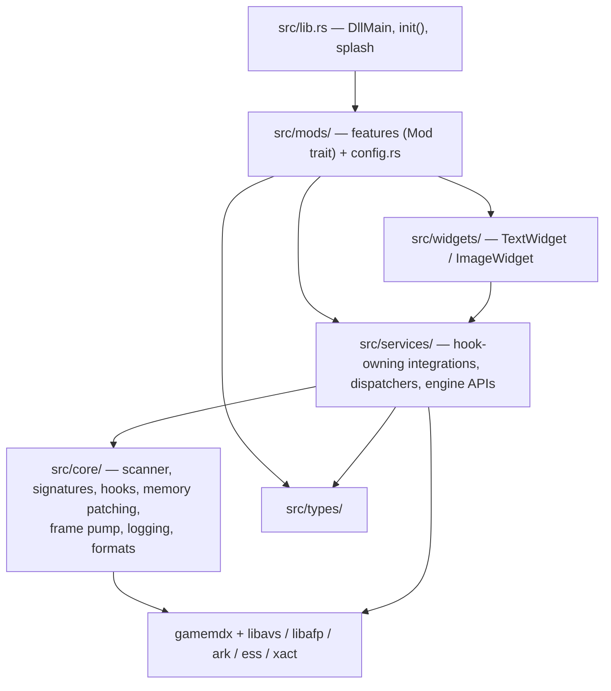
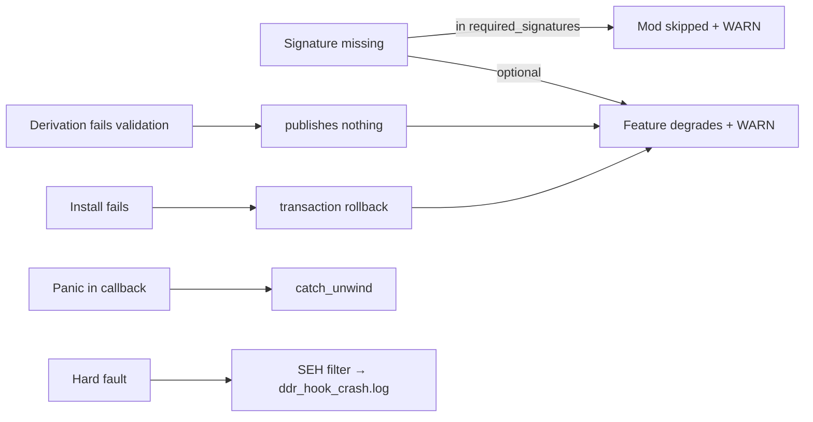
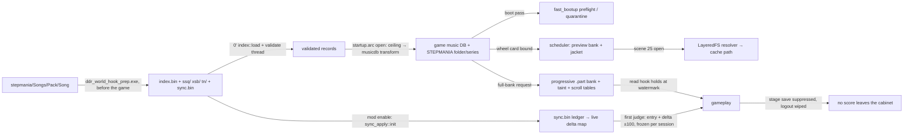

# Architecture

> Machine-generated by the codebase-summary workflow. Do not hand-edit; regenerate instead.

## The Short Version

The DLL runs **inside someone else's process**, and almost every design decision follows from that. It finds all addresses at runtime, installs detours and checked patches, and drives the game's own engine objects. The layers separate game-agnostic mechanics (`core/`), single-subsystem integrations that own hooks (`services/`), and player-facing features (`mods/`).

## Layer Model



Placement rules:

- `core/` holds nothing game-policy-specific. Format code moves here once it has a second consumer (`core/ssq/` was promoted from a mod). The StepMania conversion pipeline — `core/sm/` (SM/SSC parser, scroll gimmicks, title glyph table), `core/ssq/{writer,check}.rs`, `core/audio/`, `core/sync/`, `core/art/{jacket,placeholder,source,thumbnail}.rs`, `core/xact/{song_bank,xsb}.rs` — is pure and mounted by `#[path]` into the standalone prep tool (`prep/`, `ddr_world_hook_prep.exe`), which is the only thing that converts; the DLL only reads the cache the tool wrote.
- A `services/` module owns each hooked game function. When several features need the same function, the service is a **dispatcher** (subscribe/acquire API), and features never install a second detour. See the ownership table in `interfaces.md`. `ssq_path`, `wheel_cards` and `scroll_remap` were promoted from mod-private hooks when the StepMania loader became a second consumer.
- `mods/` implement `Mod`, consume services, and grow into a subdirectory once multi-file. `mods/stepmania_packs/` is deliberately thin: everything game-facing lives in `services/stepmania/`.
- Pure decision and format logic sits in dedicated files with no `crate::` imports, so the harnesses can mount it (for example `lifecycle.rs`, `section_math.rs`, `logic.rs`, `model.rs`, `scheduler_logic.rs`, `progressive_logic.rs`, `sync_state.rs`, `records.rs`, `validation.rs`, `ceiling.rs`, `compose.rs`). The same contract lets `prep/` compile `services/stepmania/{cache,ceiling,convert,identity,model,musicdb,records,sync_state}.rs` natively.

## Initialization Sequence

`DllMain` spawns `init()` on its own thread. The order is **load-bearing**, and the reasons are commented in `src/lib.rs`.

```mermaid
sequenceDiagram
    participant I as init thread
    participant G as game boot
    I->>I: panic hook, SEH crash handler, profiling
    I->>G: 0a ident_override (must beat the launcher to ea3_boot)
    I->>I: 0 config load (+ audio_clock config)
    I->>I: 0' stepmania::early_init (load index.bin + spawn read-only validation; register LayeredFS resolver + startup.arc musicdb transform)
    I->>G: 0b LayeredFS install (must beat onBoot's startup.arc / shader.arc / musicdb reads)
    G->>G: startup.arc open → arena patch → wait_validated(≤ VALIDATION_CAP 15 s) → ceiling → inject <music> entries
    I->>G: 1 wait for gamemdx
    I->>G: 1b XACT factory hook (before XACT initializes)
    I->>I: 2 resolve_all (batch AOB scan)
    I->>I: 2c build mods, early_apply (race-critical patches)
    I->>I: 3 resolve_derived (validated derivations)
    I->>I: 3a–6f services in dependency order
    I->>I: 7 register mods (skip on missing required sigs / init false)
    I->>I: 8 enable per config (late-binding mods last)
    I->>I: 9 mod-menu, 10 label-atlas flush, splash thread
```

Ordering constraints worth knowing:

| Constraint | Reason |
|---|---|
| `ident_override` first | It must detour `ea3_boot` before the launcher calls it. It needs neither config nor gamemdx. |
| `stepmania::early_init` after the config store, before LayeredFS | It is gated on the `stepmania-packs` toggle and reads its own section, and its `startup.arc` member transform + resolver must be registered before the hooks go live: the game drains `startup.arc` within ms of gamemdx loading, and a transform registered later misses that one open. It parses the prep tool's `index.bin` synchronously (ms) and spawns the read-only validation thread; the bounded wait on that validation happens inside the game's own open. |
| LayeredFS before the gamemdx wait and the scan | `Application::onBoot` reads `startup.arc` (the music DB), `shader.arc` (its only shader read) and `musicdb.xml` within a few hundred ms of gamemdx loading. The `startup.arc` open also carries the XML-arena patch (`song_limit_expansion::register_startup_arc_hook`) so it lands regardless of which side wins the race. |
| XACT factory hook before `resolve_all` | XACT audio threads are live after Initialize. |
| `early_apply` before derivations/services | Patches must land before the game's first use (XML buffer size, FPS target). |
| `stage_records` before persistence | The logout-save sanitiser uses the record layout. |
| `judge_hook` → `foot_panel_swap` → `analyze_hook` / `render_notes_hook` → `scroll_remap` before mod init | Dispatchers must exist before subscribers register; `scroll_remap` subscribes to `render_notes_hook`. |
| `stepmania-packs` registered before `series-expansion` / `folder-expansion` | Its `init` registers the STEPMANIA series value + folder bit (bounded wait on the index validation) when the `startup.arc` open has not done so yet; the two expansion mods merge the runtime registries in their own `init`. Idempotent — on a fast cabinet the open already did it. |
| `mod-menu` last, then one label-atlas flush | It lists every registered mod and row, and the atlas is rebuilt exactly once. |

## Thread Model

| Thread | Runs | Rules |
|---|---|---|
| Game frame seam | The one frame pump driven by `overlay_draw`'s layer-dispatcher detour. Per frame: `input_manager::poll` (all `on_frame` callbacks first, then input events), then the `run_on_render_thread` batch, then the original render | Engine mutation happens here. Never hold a state mutex across a scheduled closure. Each phase is panic-contained. `widget_renderer::is_render_thread()` identifies it. |
| Game logic / judge / scene hooks | `judgeNotes` dispatch, scene callbacks, save/load trampolines; the per-note `get_offset_y` detour (`scroll_remap`, one atomic load when idle) | Tight, panic-free, allocation-averse. The StepMania auto-sync delta provider is a map lookup + freeze (no wait: the ledger is fully loaded at enable). |
| FileManager I/O worker | The game's single file-reading thread for post-boot assets: the LayeredFS resolvers on each intercepted open, progressive-bank read holds (≤ 5 s) and the preview-ticket wait (≤ 300 ms). (The boot-time `startup.arc` open, with its bounded validation wait and the musicdb transform, runs on the game's own `onBoot` thread.) | Never the render thread (`is_render_thread()` takes the fallback at once). Bounded waits only; a timeout passes through (silence), never hangs. |
| XACT / audio render thread | audio_clock observers, song-rate IO serve | Lock- and allocation-free on the serve path |
| Engine job-graph worker | scene3d node `visit`/dtor (background dancers) | No engine API, locks, allocation or logging |
| libafp display pass | ddr_selection sound route | Lock-free, no logging |
| DLL init thread | `init()` | May block/poll; ends after splash setup |
| StepMania index validation | one read-only thread (`stepmania-validate`) spawned at step 0': stats each `index.bin` record's artefacts + source stamps (`records.rs` → `validation.rs` verdict) and drops failures; `wait_validated(VALIDATION_CAP = 15 s)` from the `startup.arc` fingerprint drops the records it has not reached | `std::fs` only (never AVS — the hooks are live); never writes `index.bin`. Conversion itself happens out of process, in `ddr_world_hook_prep.exe` before the game starts. |
| StepMania scheduler pool | `max(3, hardware_threads / 2)` workers at below-normal priority: preview banks, jackets, the progressive full bank, driven by `wheel_cards` binds and the highlight | Pure CPU/IO; tickets handed to the resolver; one INFO per job |
| fast-bootup preflight | one thread at enable: re-reads every injected SSQ and runs `check_ssq`, publishing verdicts by file name before the boot pass | Never waited on — files it has not reached are checked inline at plan build |
| Mod workers | song-rate generator, chart-length, SMX transport, tick synthesis, arc parse, cache writers, CSV writer, etc. | Pure CPU/IO. Results are handed back through atomics, seqlocks or queued closures. |

Primitives:

- `widget_renderer::run_on_render_thread` (enqueues onto `core::frame_pump::FramePump`)
- `input_manager::on_frame`
- `core::deferred_work::{PendingPump, Deadline}`

## Hook Discipline

- Detours are `retour::GenericDetour`, installed with `core::hooks::install_enabled` (store-then-enable).
- Multi-hook installs that must be atomic use `core::hook_transaction::install_all_or_rollback`.
- Byte patches go through `core::memory_patch` transactions: verify expected bytes, write, flush, read back, roll back on failure.
- Some mods clone vtables into mod-owned memory instead of patching code (option rows, foot panels, the BPL battle frame).
- Dispatcher callbacks are plain `fn` pointers, run in priority order, each wrapped in `catch_unwind`.

## Resilience Model



Deliberate fail-closed exceptions:

- **Score integrity.** Tainted saves are fully suppressed when sanitisation is unavailable (`score_guard` + `custom_options_persistence`).
- **Injected songs.** Every StepMania play is tainted (`INJECTED_SONG_TAINT`, level-written from the full-bank request; session taint for the logout wipe). If `score_guard::is_full_sanitization_available()` is false when the mods enable, `stepmania::hide` sets every injected entry's corruption flag so the next active-list rebuild drops them from the wheel. A declared chart slot is exposed only after `core::ssq::check` passed on the written file, and `fast_bootup` re-checks every injected file at boot, quarantining a failing one (hidden, never handed to the `ME1529` reporter).
- **Derivations.** A bad derivation publishes nothing, never a guessed address.
- **Pointer reads from game objects whose layout no AOB pins** are guarded with `memory::is_readable` before dereference. An identity check like `*p == vtable` does not protect a pointer read from an unpinned offset.

## StepMania Pack Flow



Cache ownership is the race-freedom argument: the tool writes `index.bin`, `ssq/`, `xsb/`, `tn/`, `sync.bin`; the DLL writes `xwb/`, `jacket/`, `lru.bin`, `thumbnail/<S>.arc`. Neither touches the other's files, and the tool refuses to run while `spice64.exe`/`spice.exe` is up.

## Cross-Cutting Systems

| System | Home | Role |
|---|---|---|
| LayeredFS | `src/services/avs_layeredfs/` | Transparent file replacement from `data_mods/`: PNG→game texture, ARC overlay/repack, XML merge, atlas cloning, runtime shader synthesis; virtual-asset resolvers, arc member transforms + fingerprints, progressive (in-flight) reads |
| StepMania pack loader | `src/services/stepmania/` + `src/core/{sm,ssq,audio,sync,art}/` + `src/mods/stepmania_packs/` + the standalone `prep/` tool | Out-of-process conversion of `stepmania/Songs/` into the cache (`ddr_world_hook_prep.exe`); in the DLL: `index.bin` load + read-only validation, the injection ceiling (`ceiling.rs`, 4,000 songs, nothing under a stock arena), music-DB injection through the `startup.arc` transform, cache-served charts/banks/art, prefetch scheduler, progressive gameplay bank, tool-measured auto-sync applied through the judgement offset, score taint + fail-closed hiding |
| Option-row framework | `src/services/custom_options/` | Declarative per-player rows in the native options menu and the overlay menu, with persistence and conditional visibility |
| Overlay mod menu | `src/mods/mod_menu/` + `src/services/overlay_draw/` | Pinpad 0-0-0 modal: mod toggles, cabinet-wide rows, themes with shader backgrounds |
| Persistence + score policy | `custom_options_persistence.rs`, `score_guard.rs`, `stage_records.rs` | `mod_*` wire fields, JSON cache, `/data` node producers; taint → suppression/sanitisation |
| Song-rate engine | `src/services/song_rate/` + `src/core/xact/` | Streamed WSOLA/resample audio, scaled clock, score containment, previews |
| Audio clock | `src/services/audio_clock/` + `audio_sync_diag::xact` | DAC-locked gameplay clock for gameplay-timing-fixes |
| In-place song reset | `src/services/song_reset/` | Restart/seek without actor teardown (quick restart, training) |
| 3D scene | `src/services/scene3d/` | Render items, nodes, camera, viewport passes for background dancers |
| Event backbones | `scene_manager`, `input_manager`, `judge_hook` | Scene/frame/input/judge dispatch that most mods subscribe to |
